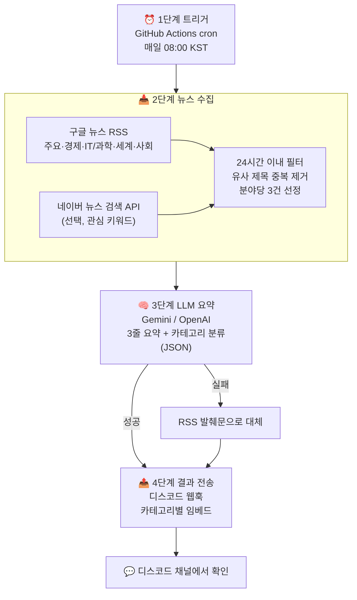
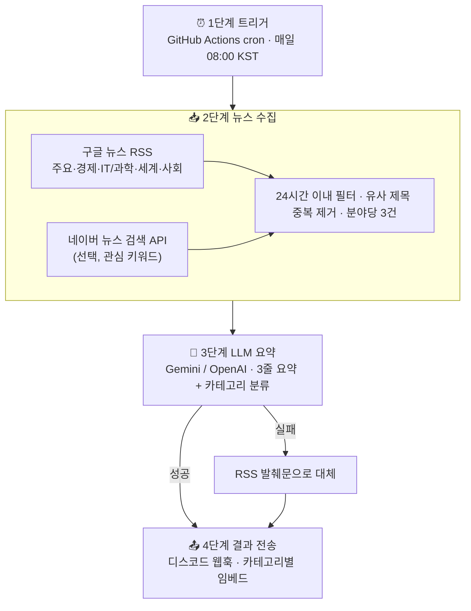
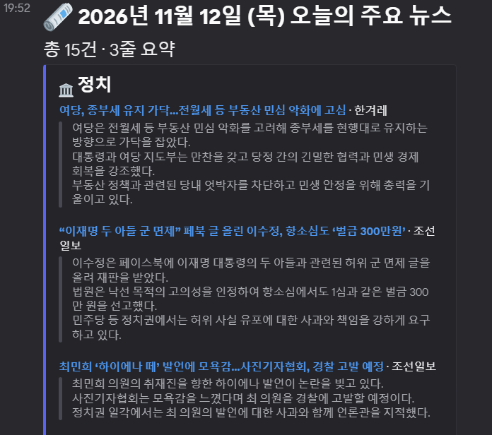

# 🗞️ 디스코드 데일리 뉴스봇

> **Workflow / AI Agent 개발 과제** 제출물
> 매일 아침 8시, 그날의 주요 뉴스를 **3줄 요약 + 카테고리 분류**해서 디스코드 채널로 보내주는 봇

---

## 📌 과제 개요

평소 생활이나 학업에서 불편했던 문제를 해결하거나, 직접 만들어 보고 싶었던 서비스를 자유롭게 선정하여 **Workflow 또는 AI Agent 방식**으로 구현하는 프로젝트입니다.
수업에서 배운 개념과 기술을 실제 프로젝트에 적용해 보는 것이 목적이며, 복잡하거나 거창한 시스템보다 **작더라도 실제로 동작하는 프로그램**을 만드는 데 중점을 두었습니다.

### 과제 수행 내용과 이 프로젝트의 대응

| 과제 항목 | 이 프로젝트에서 수행한 내용 | 참고 섹션 |
|---|---|---|
| 1. 주제 선정 | 매일 뉴스를 일일이 찾아보는 번거로움 해결 → 데일리 뉴스 요약봇 | [1. 주제 선정](#1-주제-선정) |
| 2. 시스템 설계 | Workflow 방식 선택, 4단계 처리 흐름 설계 | [2. 시스템 설계](#2-시스템-설계) |
| 3. 기술 활용 | 스케줄러, RSS/API 수집, LLM 프롬프트 기반 요약, 웹훅 | [3. 사용 기술](#3-사용-기술) |
| 4. 구현 및 테스트 | `news_bot.py` 구현, 모의 테스트 및 실제 실행 결과 확인 | [5. 실행 결과](#5-실행-결과) |

### 제출물 체크리스트

- [x] 프로젝트 소스코드 — `news_bot.py`, `.github/workflows/daily-news.yml`
- [x] README.md (프로젝트 소개, 사용 기술, 실행 방법) — 이 문서
- [x] 시스템 처리 흐름도 — [`docs/flowchart.png`](docs/flowchart.png)
- [ ] 실행 결과 (스크린샷 또는 시연 영상) — `docs/screenshot.png` *(실행 후 추가)*
- [x] API Key·비밀번호 미포함 — `.env`는 `.gitignore`로 제외, 키는 GitHub Secrets로 관리

---

## 1. 주제 선정

**문제**: 매일 여러 포털·언론사를 돌아다니며 뉴스를 확인하는 것이 번거롭고, 제목만 보고는 핵심 내용을 파악하기 어렵다.

**해결**: 정해진 시간에 주요 뉴스를 자동으로 모아 AI가 3줄로 요약하고, 평소 자주 쓰는 디스코드로 보내준다.

**선정 이유**
- **실용성**: 일상에서 매일 겪는 불편을 직접 해결하는 서비스
- **구현 현실성**: 데이터 수집 → 요약 → 전송까지 처리 흐름이 명확해, 프로젝트 기간 안에 안정적으로 동작하는 결과물을 만들 수 있음

---

## 2. 시스템 설계

### Workflow vs Agent 비교

| 구분 | **Workflow (채택)** | AI Agent |
|---|---|---|
| 동작 방식 | 수집 → 요약 → 전송 순서가 코드로 고정 | AI가 검색·선별 과정을 스스로 판단 |
| 장점 | 매일 정해진 시간에 오차 없이 같은 품질로 동작 | 특정 키워드 심층 검색, 중복 기사 필터링을 자율 수행 |
| 적합한 경우 | 지정된 언론사·RSS의 톱뉴스를 매일 아침 받아볼 때 | 사용자 관심사에 맞춰 AI가 직접 웹을 검색하고 큐레이션할 때 |

**Workflow를 선택한 이유**: 이 서비스의 핵심은 "매일 아침 빠짐없이, 일정한 품질로" 받아보는 것입니다. 따라서 흐름 제어는 전부 코드가 담당하고, LLM은 3단계의 **요약·분류 도구**로만 사용했습니다. Agent 방식의 장점인 중복 기사 필터링은 규칙 기반(제목 유사도)으로 구현해 Workflow 안에 포함했습니다.

### 시스템 처리 흐름도





### 단계별 처리 내용

| 단계 | 내용 | 구현 위치 |
|---|---|---|
| 1. 트리거 | GitHub Actions cron이 매일 23:00 UTC(= 08:00 KST)에 실행 | `.github/workflows/daily-news.yml` |
| 2. 수집 | 구글 뉴스 RSS 5개 분야 + 네이버 API(선택) → 24시간 이내 기사 → 중복 제거 → 분야당 3건 | `collect()` |
| 3. 요약 | 선정 기사를 한 번의 LLM 호출로 전달 → 기사별 3줄 요약 + 7개 카테고리 분류(JSON) | `summarize()` |
| 4. 전송 | 카테고리별 색상 임베드로 디스코드 웹훅 전송 (한도 초과 시 자동 분할) | `send_discord()` |

### 안정성 장치
- 피드 하나가 실패해도 나머지로 계속 진행
- 429/5xx 응답은 자동 재시도 (지수 백오프)
- 기사를 5건씩 나눠 요약 요청 → 응답이 빠르고, 한 묶음이 실패해도 나머지는 요약됨
- Gemini 3 계열의 추론(thinking) 강도를 `low`로 낮춰 응답 시간 단축 (요약에는 깊은 추론이 불필요)
- 503(과부하)은 간격을 늘려 재시도, 시간 초과는 1회만 재시도 후 가볍고 빠른 lite 모델부터 다른 Flash 모델로 자동 전환
- 지원 종료된 모델이면 오류 메시지가 안내하는 새 모델로 자동 교체
- 요약 단계에 시간 제한(기본 7분)을 두고, 모든 모델이 실패하면 RSS 발췌문으로 대체해서라도 전송
- API 키는 URL이 아닌 요청 헤더로 보내 로그에 노출되지 않음
- 디스코드 한도(메시지당 임베드 10개, 6000자)에 맞춰 메시지 자동 분할

---

## 3. 사용 기술

| 분류 | 기술 | 용도 |
|---|---|---|
| 언어 | Python 3.9+ (표준 라이브러리만 사용) | 전체 로직 |
| 스케줄러 | GitHub Actions `schedule` (cron) | 1단계 트리거 |
| 데이터 수집 | 구글 뉴스 RSS, 네이버 뉴스 검색 API | 2단계 수집 |
| 텍스트 처리 | XML 파싱, 문자 2-gram 자카드 유사도 | 중복 기사 제거 |
| LLM | Google Gemini API (`gemini-3.8-flash`) / OpenAI API (`gpt-4o-mini`) | 3단계 요약·분류 |
| 프롬프트 엔지니어링 | 역할 지정, 출력 형식(JSON) 강제, 환각 방지 지시 | 3단계 요약 품질 |
| 메신저 연동 | Discord Webhook (Embed) | 4단계 전송 |
| 보안 | GitHub Secrets, `.env` + `.gitignore` | API 키 보호 |

---

## 4. 실행 방법

### 4-1. 키 준비
1. **디스코드 웹훅**: 채널 설정 → 연동 → 웹후크 → 새 웹후크 → *웹후크 URL 복사*
2. **Gemini API 키**: https://aistudio.google.com/apikey (무료 티어로 충분)
3. *(선택)* **네이버 API**: https://developers.naver.com → 애플리케이션 등록 → 검색 API

### 4-2. 로컬 실행
```bash
git clone <이 저장소 URL>
cd news-bot
cp .env.example .env     # .env 파일에 키 입력
python news_bot.py
```
`DISCORD_WEBHOOK_URL`을 비워두면 디스코드 대신 콘솔에 결과만 출력합니다.

### 4-3. 매일 자동 실행 (GitHub Actions, 무료)
1. 저장소 **Settings → Secrets and variables → Actions**
   - **Secrets**: `DISCORD_WEBHOOK_URL`, `GEMINI_API_KEY` (선택: `OPENAI_API_KEY`, `NAVER_CLIENT_ID`, `NAVER_CLIENT_SECRET`)
   - **Variables** (선택): `LLM_PROVIDER`(`gemini`/`openai`), `GEMINI_MODEL`(기본 `gemini-3.8-flash`), `NAVER_QUERIES`(예: `반도체,인공지능`)

> 💡 Gemini 모델은 주기적으로 지원이 종료됩니다. 로그에 `model ... is no longer available` 오류가 보이면 코드를 고칠 필요 없이 **Variables에 `GEMINI_MODEL`을 오류 메시지가 안내하는 새 모델명으로 등록**하면 됩니다.
2. **Actions 탭 → Daily News Bot → Run workflow**로 즉시 테스트
3. 이후 매일 08시 무렵 자동 실행 (GitHub 사정상 수 분~십여 분 늦을 수 있음)

> 💡 공개 저장소는 60일간 커밋이 없으면 예약 실행이 자동 중지됩니다. 알림 메일이 오면 Actions 탭에서 다시 활성화하세요.

**대안 스케줄러**: 항상 켜진 PC나 라즈베리파이가 있다면 cron으로도 실행할 수 있습니다.
```
0 8 * * * cd /path/to/news-bot && /usr/bin/python3 news_bot.py >> bot.log 2>&1
```

### 4-4. 커스터마이즈

| 하고 싶은 것 | 수정 위치 |
|---|---|
| 수집 분야/언론사 RSS 변경 | `news_bot.py`의 `SECTIONS` (예: 연합뉴스 `https://www.yna.co.kr/rss/news.xml`) |
| 기사 수 조절 | `ARTICLES_PER_SECTION` 환경변수 |
| Gemini 대체 모델 지정 | `GEMINI_FALLBACK_MODELS` (쉼표 구분, 비우면 자동 탐색) |
| 요약 묶음 크기 / 시간 제한 | `SUMMARY_BATCH` / `LLM_TIME_BUDGET` |
| Gemini 추론 강도 | `GEMINI_THINKING` (`low` 기본 / `default`) |
| 전송 시간 변경 | `daily-news.yml`의 cron (UTC 기준, KST −9시간) |
| 요약 스타일 | `news_bot.py`의 `PROMPT` |
| 카테고리 | `CATEGORIES`, `CATEGORY_STYLE` |

---

## 5. 실행 결과

### 디스코드 수신 화면

<!-- 실제 실행 후 디스코드 화면을 캡처해 docs/screenshot.png 로 저장하세요 -->


### 실행 로그 예시
```
⏰ [1단계] 실행 시작 2026-11-12 08:00 KST
📥 [2단계] 뉴스 수집
  · 주요뉴스: 38건
  · 경제: 35건
  · IT/과학: 34건
  · 세계: 36건
  · 사회: 37건
  → 중복 제거 후 15건 선정
🧠 [3단계] LLM 요약 (gemini)
  → 15/15건 요약 완료
📤 [4단계] 디스코드 전송
  → 1개 메시지 전송 완료
✅ 완료
```
*(건수는 실행 시점에 따라 달라집니다. 실제 실행 로그는 Actions 탭의 실행 기록에서 확인할 수 있습니다.)*

### 테스트 내용
| 테스트 | 방법 | 결과 |
|---|---|---|
| 전체 흐름(수집→요약→전송) | 네트워크 응답을 모의(mock) 데이터로 대체해 실행 | ✅ 정상 동작 |
| 24시간 지난 기사 제외 | 오래된 날짜의 기사 포함 RSS 입력 | ✅ 제외됨 |
| 중복 기사 제거 | `[속보] 한국은행 기준금리 3.0% 동결` vs `한국은행, 기준금리 3.0%로 동결` | ✅ 중복으로 판정 |
| LLM 실패 대비 | API 오류(403) 강제 발생 | ✅ 발췌문으로 대체 전송 |
| 모델 지원 종료 대응 | `models/... is no longer available` 404 응답 모의 | ✅ 안내된 새 모델로 자동 교체 |
| 모델 과부하 대응 | 기본 모델에 503 응답 지속 | ✅ 대체 Flash 모델로 전환 후 12/12건 요약 |
| 응답 지연 대응 | 기본 모델 시간 초과 + 2순위 모델 503 | ✅ lite 모델로 전환 후 15/15건 요약 |
| 전체 모델 장애 | 모든 모델 503 | ✅ 시간 내 중단, 발췌문으로 대체 전송 |
| 실제 운영 | GitHub Actions 수동 실행 | *(스크린샷 첨부)* |

---

## 6. 파일 구성
```
news-bot/
├── news_bot.py                       # 1~4단계 전체 로직
├── .env.example                      # 환경변수 템플릿 (실제 키 없음)
├── .gitignore                        # .env 등 민감 파일 제외
├── .github/workflows/daily-news.yml  # 매일 08:00 KST 스케줄
├── docs/
│   ├── flowchart.png                 # 시스템 처리 흐름도
│   ├── flowchart.mmd                 # 흐름도 원본 (Mermaid)
│   └── screenshot.png                # 실행 결과 화면 (추가 예정)
└── README.md
```

---

## 7. 보안 유의사항
- API Key, 웹훅 URL 등 민감한 정보는 **저장소에 업로드하지 않습니다.**
- 로컬에서는 `.env` 파일(`.gitignore`로 제외), GitHub Actions에서는 **Secrets**로만 관리합니다.
- 디스코드 웹훅 URL이 유출되면 누구나 채널에 메시지를 보낼 수 있으므로, 유출 시 즉시 웹훅을 삭제하고 새로 발급하세요.

---

## 8. 참고 자료 및 출처

| 항목 | 출처 | 활용 내용 |
|---|---|---|
| 구글 뉴스 RSS | https://news.google.com/rss | 분야별 헤드라인 수집 |
| 네이버 뉴스 검색 API | https://developers.naver.com/docs/serviceapi/search/news/news.md | 키워드 뉴스 수집 (선택) |
| Gemini API | https://ai.google.dev/gemini-api/docs | 기사 요약·분류 |
| OpenAI API | https://platform.openai.com/docs | 기사 요약·분류 (대체) |
| Discord Webhook | https://discord.com/developers/docs/resources/webhook | 결과 전송 |
| GitHub Actions | https://docs.github.com/actions | 매일 자동 실행 |
| **AI 도구** | **Claude (Anthropic)** | 코드 초안 작성, 테스트 코드 작성, README 구성 보조 |

- 요약은 RSS의 **제목과 발췌문**만 근거로 생성합니다. 기사 본문 전체를 수집하지 않아 언론사 저작권 문제를 피하며, 원문은 각 제목 링크로 확인합니다.
- 별도의 외부 오픈소스 라이브러리는 사용하지 않았습니다 (Python 표준 라이브러리만 사용).
